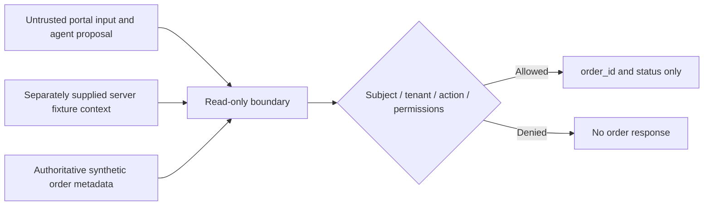

# Boundary contract: a proposal cannot grant order access

**Contribution 004 · Scheduled 21 November 2026 · Original local control contract**

Connect this contract to [day-one action ownership](scope-and-evidence.md) and [ASVS 5.0.0 authorization](https://github.com/OWASP/ASVS/blob/5cf9b032440be53ce345ab3c130fda46ba1ce7a2/5.0/en/0x17-V8-Authorization.md). Its implementation is [the local boundary module](../../tools/week01_boundary.py), not a deployed identity or order service.

## Trusted inputs and their limits

| Input | Why the local example treats it as authoritative | Missing deployment evidence |
|---|---|---|
| Originating subject, tenant and explicit permission list | Supplied separately by the test harness as server-fixture context | Real authentication, verified issuer, audience, expiry and request binding |
| Registered service action permissions | Separately supplied context, independent of the agent's text | Workload identity, durable delegation and revocation |
| Order tenant and owner | Metadata from the fixture-owned order dictionary | Database policy, data integrity and transactional consistency |
| Read-only action registry and response fields | Fixed code choices | Deployed configuration, release integrity and independent review |

## Untrusted inputs

Portal body, client tenant/role claims, user messages, model/agent output, order identifiers, suggested actions and any claimed “approval.” None may create identity, grant a role, choose the authorization tenant, add a service permission or authorize a new data exit.

## Decision contract



1. Reject absent/malformed separately supplied context.
2. Require an explicit originating-subject permission and a registered service permission for `read_order`.
3. Treat the proposed action and object reference as a request. Only the fixed read action is allowed in this experiment.
4. Resolve the object in the authoritative local store, then check **both** its tenant and owner against the originating subject.
5. Recheck at the mocked order-API dispatch step. Return only `order_id` and `status`.
6. Record a metadata-only local decision. Diagnostic copies and additional destinations are outside this contract.
7. Deny when required evidence for the proposed local dispatch is absent. Keep an unknown original-backend assessment separate from that proposed denial.

The read response remains available for A01; A02 and P01 cannot obtain another customer's order through the proposed gate. P02 cannot gain authority from an agent's administrator claim when its trusted context is missing.

## Worked example and reproduction

[Worked P01 decision](worked-example.md) · [Boundary tests](../../tests/test_week01_boundary.py).

```bash
python3 -m unittest discover -s tests -p 'test_week01_boundary.py' -v
```

Refunds, payment execution, real approvals, learned-model behavior, authentication, revocation, network policy, durable logging and concurrency protection are outside this read-only local contract. It changes a mock decision, not a deployment or compliance status.
