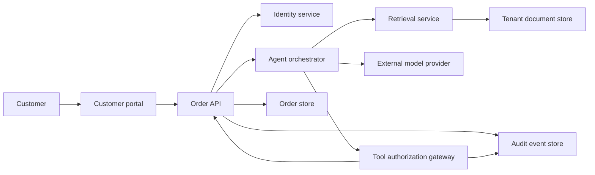

# Sentinel Logistics: system scope and asset inventory

**Day 001 · 18 November 2026 · Synthetic reference design**

## Scope

Sentinel Logistics is a fictional customer order service with an AI support assistant. This first design covers order-status requests, tenant-scoped document retrieval, refund proposals, human approval, and authorized refund execution.

The reference includes a customer portal, identity service, order API, agent orchestrator, retrieval, tool gateway, stores, logging, and an external model dependency. Payments, warehouse equipment, model training, and production cloud configuration are outside this first scope.

All records below are **proposed**. No live environment, employee assignment, network traffic, or permission configuration was inspected.

## Proposed system relationships

This diagram shows intended routes. Arrows do not prove authorization, data filtering, encryption, or isolation.

## Proposed asset inventory

The roles below identify who would need to accept ownership. They are not assignments to real people.

| ID | Asset | Proposed identity or access context | Data or authority | Proposed accountable role | Validation status |
| --- | --- | --- | --- | --- | --- |
| A01 | Customer portal | Customer session | User input and displayed order information; no independent mutation authority | Application lead | Design only |
| A02 | Order API | Verified customer or support subject; scoped service callers | Tenant-owned order reads and explicitly authorized mutations | Application lead | Design only |
| A03 | Identity service | Identity administration and token verification | Subject, tenant, role, and service claims | IAM lead | Design only |
| A04 | Agent orchestrator | Scoped job identity | Receives input and proposes actions; no direct database access | AI platform lead | Design only |
| A05 | Tool authorization gateway | Registered service identity plus verified delegated context | Evaluates tool name, action, resource, and approval before dispatch | Application security lead | Design only |
| A06 | Order store | Order API service identity | Synthetic tenant-owned orders and refund state | Data platform lead | Design only |
| A07 | Retrieval service | Request-bound tenant context | Retrieves only documents permitted for that request | AI platform lead | Design only |
| A08 | Tenant document store | Scoped retrieval service identity | Synthetic tenant documents and source metadata | Data platform lead | Design only |
| A09 | External model provider | Supplier integration identity | Receives a minimized prompt; no direct order-system access | AI integration owner | Design only |
| A10 | Audit event store | Authorized event writers and investigation readers | Actor, tenant, resource, action, decision, and correlation fields | Security operations lead | Design only |

## Intended authorized flows

| ID | Intended route | Proposed boundary rule | Evidence needed to validate it |
| --- | --- | --- | --- |
| F01 | Customer → portal → order API | Treat client input and client role claims as untrusted | Server-side request validation and authorization tests |
| F02 | Order API → identity service | Verify subject and tenant context before protected operations | Token-verification configuration and rejected invalid-context cases |
| F03 | Order API → agent orchestrator | Delegate an explicit job scope; user instructions do not expand it | Job-context schema and out-of-scope action tests |
| F04 | Agent → retrieval → tenant document store | Filter by the request's authorization before documents enter model context | Mixed-tenant retrieval fixtures and permitted/denied results |
| F05 | Agent → external model provider | Send only the fields allowed by the supplier integration policy | Prompt-construction logic, field review, and redacted request trace |
| F06 | Agent → tool gateway | Treat the action as a proposal requiring independent checks | Tool registration, argument validation, and gateway decision tests |
| F07 | Tool gateway → order API → order store | Check identity, tenant, order, action, and required approval before mutation | Approval-policy definition and valid/invalid execution tests |
| F08 | Order API and gateway → audit event store | Record attributable decisions without raw secrets or unnecessary customer content | Event schema, sample events, and access/retention configuration |

A route absent from this intended map requires review. This document does not demonstrate that unlisted routes are technically blocked.

## Proposed action ownership

| Action | Proposed authority | Proposed enforcement point | Role that must accept ownership |
| --- | --- | --- | --- |
| Read order status | Customer or authorized support subject for a permitted order | Order API | Application lead |
| Retrieve supporting documents | Request-bound identity permitted to access the relevant tenant documents | Retrieval authorization filter | Data platform lead |
| Propose a refund | Scoped agent job; proposal has no payment or order-state effect | Proposal workflow | Product owner |
| Approve a refund | Designated human role under a defined business policy | Approval workflow | Business process owner |
| Execute a refund | Registered service with valid subject, resource, action, and approval context | Tool gateway and order API | Application lead |

## Evidence gaps and next checks

- **Owner acceptance:** confirm who owns each asset and action boundary in a real deployment.
- **Runtime reachability:** compare the intended map with service, network, and tool configuration.
- **Tenant binding:** verify that tenant context comes from trusted authentication and survives retrieval and tool calls.
- **Supplier data exit:** inspect which fields actually leave the system and under which integration policy.
- **Inventory changes:** test whether a newly registered tool or changed destination triggers review.

## Source boundary

The accompanying [evidence note](evidence-note.md) connects this design to NIST CSF 2.0 asset-management outcomes. The record schema, ownership roles, refund separation, and authorization rules above are original proposals for this synthetic example.

Completion of this document means the proposed scope is inspectable. It does not mean the proposed controls have passed their checks.
